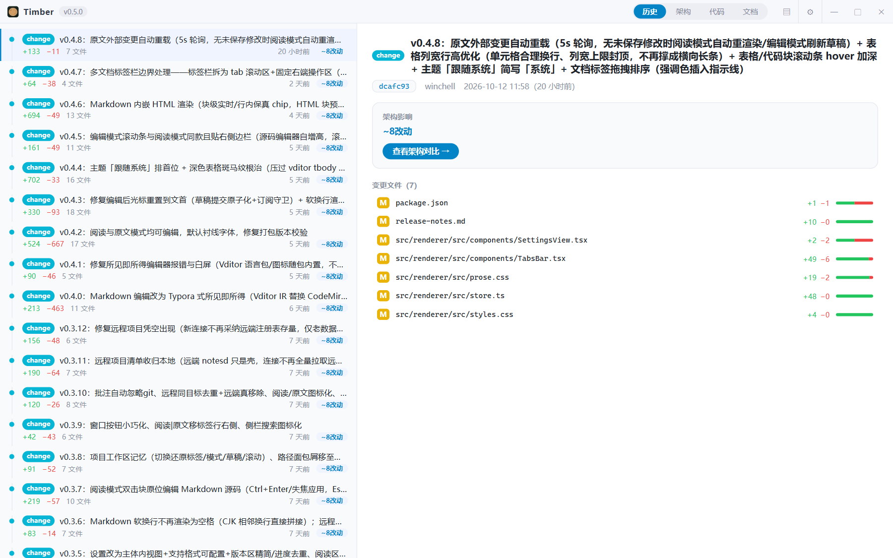

<p align="center">
  
</p>

# Timber

看清每一次提交如何塑造你的项目 —— Git 历史 × 架构图 × 代码阅读 × 文档渲染



[](https://github.com/salmoshu/Timber/releases)
[](LICENSE)


## 为什么

AI 时代，代码越写越快，但「项目是怎么一步步长成这样的」越来越模糊。Timber 把项目的**时间维度**（Git 历史）和**空间维度**（架构）放到同一个视图里：每次提交改了什么、对架构产生了什么影响，一眼看清。年轮即历史——这是 Timber 名字的由来。

## 四个视图

- **文档** —— 超越一般 IDE 的渲染：Markdown（GFM、KaTeX 公式、mermaid/echarts/graphviz 等十余种图表，全部离线内置）、HTML 真实渲染、划词批注、全文搜索、多标签（右键菜单/拖拽排序/一键刷新）；图片点击最大化查看细节
- **代码** —— 编辑器式只读阅读器：语法高亮、行号、文件树（默认折叠，按需展开），从提交详情一键跳到改动文件
- **架构** —— 基于 [Archify](https://github.com/tt-a1i/archify) 技术：静态分析仓库目录、import 关系与 **Electron IPC 通道**生成架构图（组件卡含规模/行数/提交热度，自包含交互 HTML，深/浅主题首次随系统、切换后独立记忆，聚焦追踪）；**对比模式**渲染任意两个提交之间的架构 delta（新增/移除/改动的组件与连接高亮呈现）；**矩阵模式**以 DSM 依赖结构矩阵呈现组件依赖并高亮循环依赖；**洞察模式**给出组件度量、顶层符号榜与 Tarjan 循环依赖检测
- **历史** —— 提交时间线：类型徽章（feat/fix/docs/refactor…）、变更统计、相对时间；每个提交标注**架构影响**（+N 组件 −N 连接），点开看文件级 diff 与完整说明

## 安装

从 [Releases](https://github.com/salmoshu/Timber/releases) 下载最新 `Timber-Setup-x.y.z.exe`（Windows 10/11 x64）。

> 安装包未做代码签名，首次运行 Windows SmartScreen 可能提示，点击"更多信息 → 仍要运行"即可。

## 技术架构

| 层 | 技术 | 说明 |
| --- | --- | --- |
| 桌面壳 | Electron 33 + electron-vite | 单实例、外链浮层、自动更新 |
| 前端 | React 18 + Zustand + Vditor | 四视图切换；可纯 Web 预览（`pnpm dev:web`） |
| 本地服务 | Go（timberd sidecar） | Git 历史提取、仓库静态分析（目录→组件、import→连接）、文档扫描/批注/搜索、WSL/SSH 远端接入 |
| 架构渲染 | [Archify](https://github.com/tt-a1i/archify)（vendor 于 `vendor/archify`，MIT） | JSON IR → 自包含交互 HTML；`architecture-delta` 计算两版本架构差异 |

数据流：sidecar 从 Git 提取提交与代码结构 → 主进程调用 archify 渲染/比对 → 渲染层以 iframe 呈现交互架构图。

## 开发

```bash
pnpm install        # 安装依赖（含 sidecar 构建与 vditor 离线库注入）
pnpm dev            # Electron 开发模式
pnpm dev:web        # 纯 Web 预览（需先手动启动 sidecar）
pnpm build          # 构建
pnpm dist           # 打包 NSIS 安装包
```

## 许可

MIT。架构图渲染基于 MIT 许可的 [Archify](https://github.com/tt-a1i/archify)（见 `vendor/archify/LICENSE` 与 `THIRD_PARTY_NOTICES.md`）。
